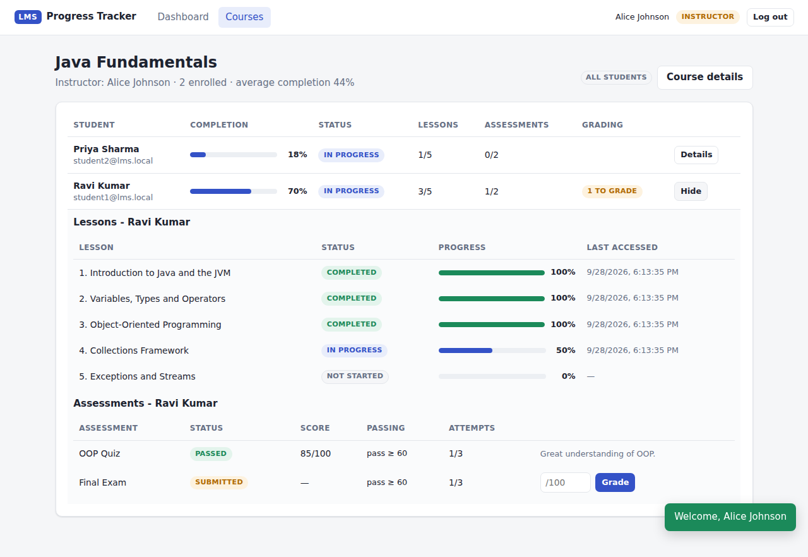
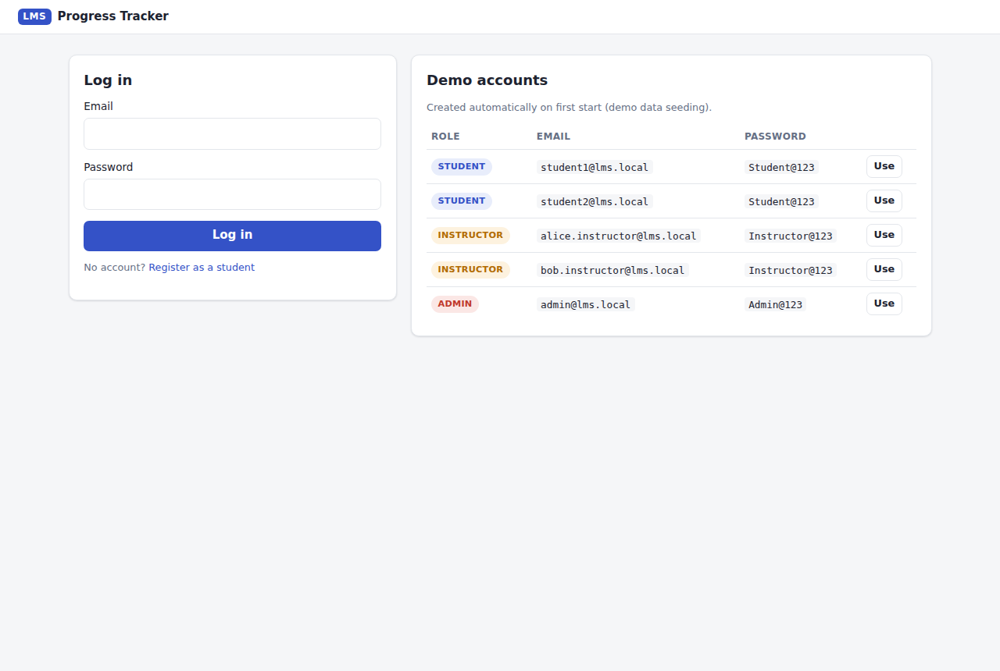
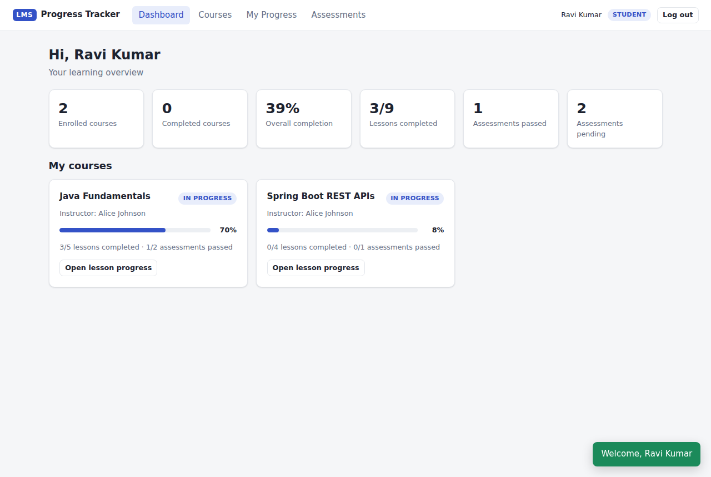
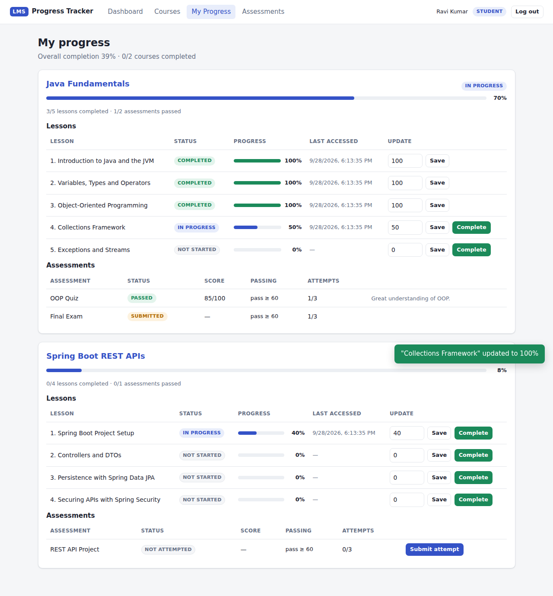
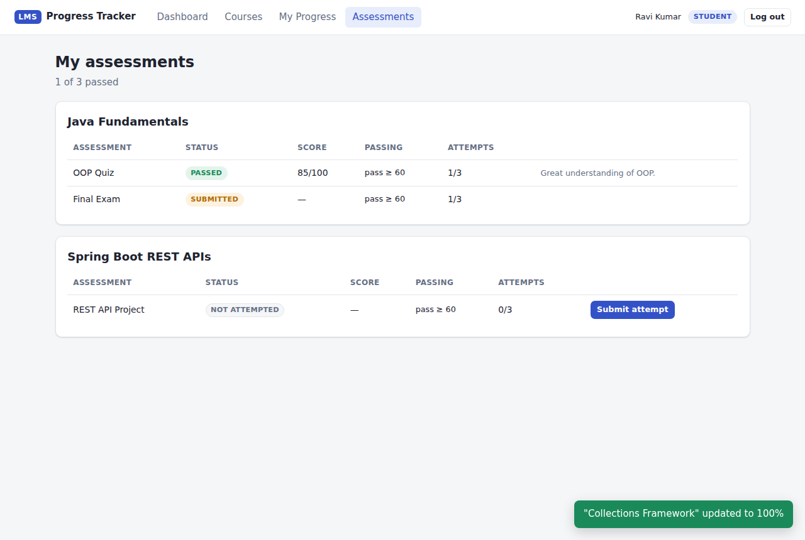
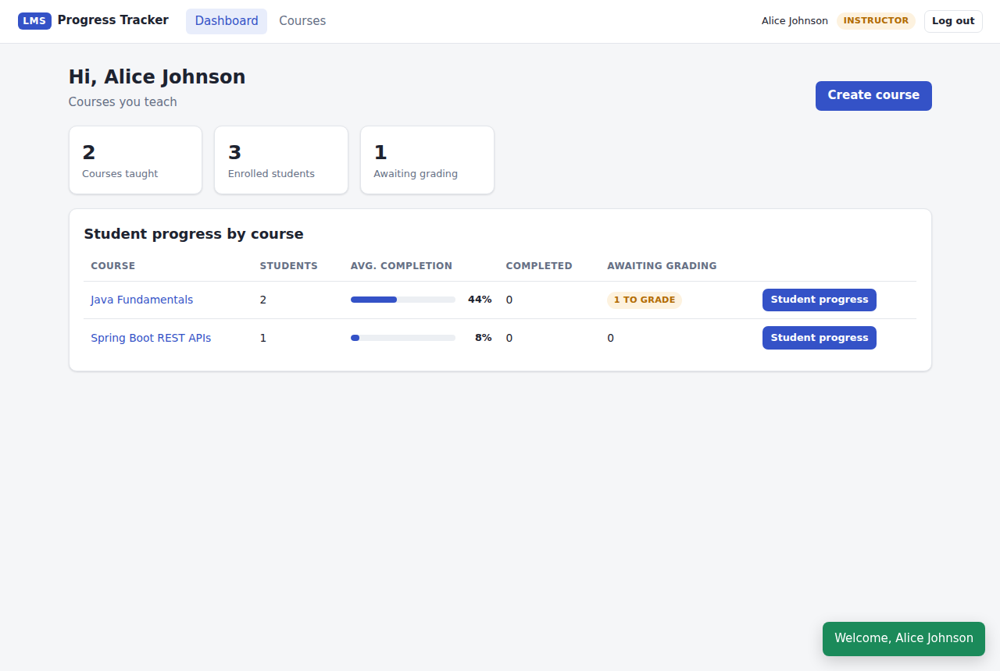
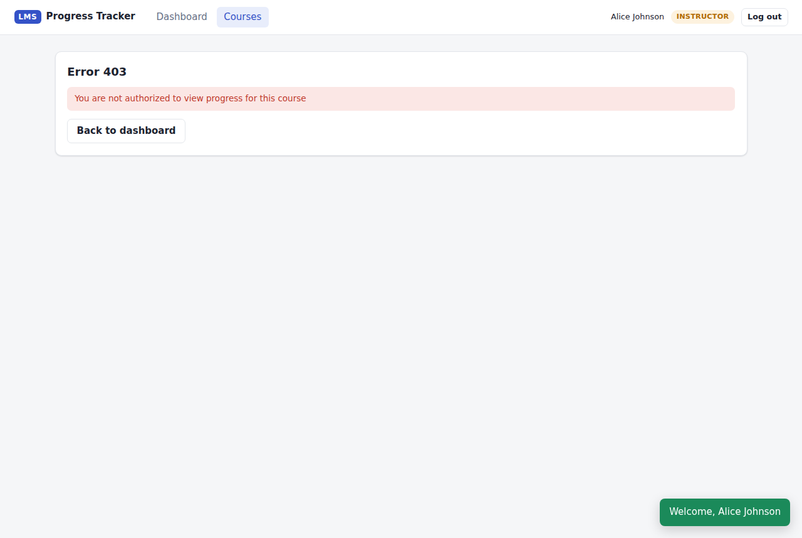
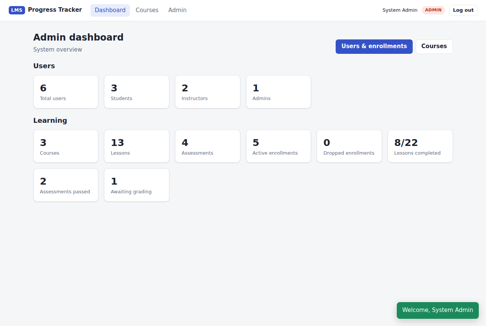
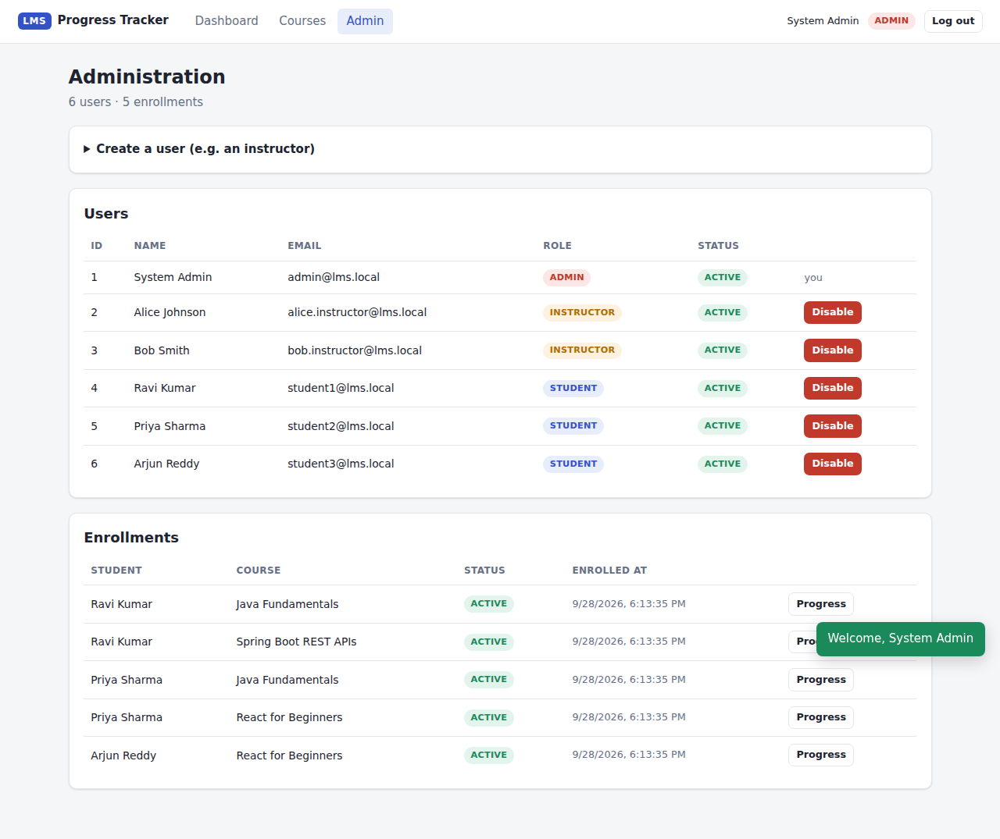
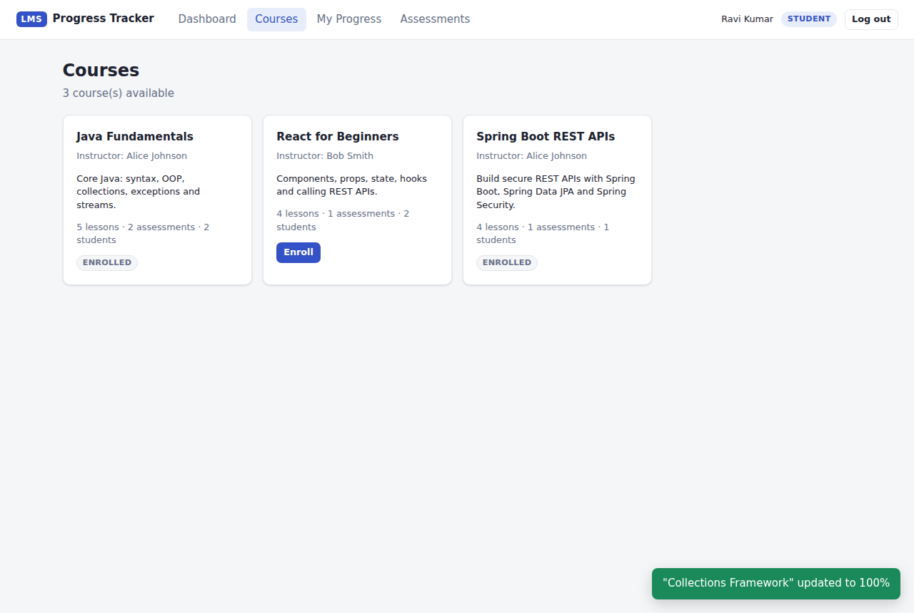

# LMS – Student Progress & Assessment Tracking

A secure Spring Boot MVP for a Learning Management System module that tracks **lesson progress**, **course completion** and **assessment status**.
Students see their own progress. Instructors see the progress of students in the courses they teach. Admins see everything.

The main focus is **security**: stateless JWT authentication, role-based access control, and **object-level authorization (IDOR / BOLA protection)** enforced in the service layer.



---

## Contents

1. [Features](#features)
2. [Technology stack](#technology-stack)
3. [Architecture](#architecture)
4. [Database schema](#database-schema)
5. [Setup instructions](#setup-instructions)
6. [How to run the backend](#how-to-run-the-backend)
7. [How to run the frontend](#how-to-run-the-frontend)
8. [Test credentials](#test-credentials)
9. [Authentication instructions](#authentication-instructions)
10. [API endpoints](#api-endpoints)
11. [How the progress APIs work](#how-the-progress-apis-work)
12. [Security controls](#security-controls)
13. [Testing instructions](#testing-instructions)
14. [Screenshots](#screenshots)
15. [Project structure](#project-structure)

---

## Features

**Students**
- Register, log in, log out
- Browse the course catalog, enroll in and leave courses
- See course completion %, per-lesson progress and assessment status
- Update their own lesson progress (percentage / mark complete)
- Submit assessment attempts (limited number of attempts)

**Instructors**
- Create courses, add lessons and assessments to courses they own
- See every enrolled student's progress in **their** courses only
- Grade submitted assessment attempts for their courses
- Dashboard: courses taught, enrolled students, average completion, submissions waiting for grading

**Admins**
- System dashboard (users, courses, enrollments, completion statistics)
- List users, create users with any role (e.g. instructors), enable / disable accounts
- View all enrollments and any course's progress; correct progress records (audited)

**Platform**
- REST API with DTOs, Bean Validation and consistent JSON errors
- MySQL persistence with foreign keys, unique constraints, CHECK constraints and indexes
- Simple, clean single-page frontend served by the same application (no build step)
- Demo data seeded on first start so every screen has content immediately
- Unit, integration and security tests (H2 in-memory, no MySQL needed for tests)

## Technology stack

| Layer | Technology |
|---|---|
| Language | Java 17 (runs on 17, 21 or newer) |
| Framework | Spring Boot 3.5 (Spring Web, Spring Data JPA, Spring Security, Bean Validation) |
| Auth | JWT (HS256) via `jjwt` 0.12, BCrypt password hashing |
| Database | MySQL 8 (H2 in-memory for tests and the optional `demo` profile) |
| ORM | Hibernate 6 / JPA |
| Logging | SLF4J + Logback, request correlation id in every log line |
| Frontend | HTML + CSS + vanilla JavaScript (ES modules) |
| Tests | JUnit 5, Spring Boot Test, MockMvc, Mockito, AssertJ |
| Build | Maven |

## Architecture

```
 Browser (static SPA: index.html, js/app.js, js/api.js)
    │  fetch() + "Authorization: Bearer <JWT>"
    ▼
┌────────────────────────────── Spring Boot application ───────────────────────────────┐
│ RequestIdFilter ─► Spring Security filter chain                                        │
│                    ├─ JwtAuthenticationFilter  (verify signature/expiry/revocation,     │
│                    │                            load user + role FROM THE DATABASE)     │
│                    └─ URL rules (/api/admin/** = ADMIN, /api/** = authenticated)        │
│                                                                                        │
│  controller/   @RestController + @PreAuthorize (coarse role gate) + @Valid input       │
│      │                                                                                 │
│      ▼                                                                                 │
│  service/impl/ business logic + OBJECT-LEVEL AUTHORIZATION via security/AccessPolicy   │
│      │         (load the object, then check ownership / enrollment / course owner)     │
│      ▼                                                                                 │
│  repository/   Spring Data JPA, fetch-join queries (no N+1, no lazy-loading leaks)     │
│      │                                                                                 │
│      ▼                                                                                 │
│  MySQL 8  (schema: src/main/resources/db/schema-mysql.sql)                             │
│                                                                                        │
│  exception/GlobalExceptionHandler (@RestControllerAdvice) → one JSON error format       │
└────────────────────────────────────────────────────────────────────────────────────────┘
```

Key design decisions:

- **Controller → Service → Repository → Database.** Controllers never touch repositories.
- **DTOs everywhere.** JPA entities never leave the service layer, so there is no infinite JSON recursion, no lazy-loading exceptions and no accidental field exposure (e.g. password hashes). `spring.jpa.open-in-view=false`.
- **Two authorization layers.** `@PreAuthorize` rejects the wrong *kind* of user early; `AccessPolicy` (called from services) decides whether *this* user may act on *this* object. The service layer is safe even if a controller annotation were forgotten (proven by `ProgressServiceImplTest`, which calls the service directly).
- **The identity always comes from the verified token**, never from a request parameter or body.

## Database schema

Tables: `roles`, `users`, `courses`, `lessons`, `enrollments`, `progress`, `assessments`, `assessment_results`, `revoked_tokens`.

```
roles 1 ──< users
users (INSTRUCTOR) 1 ──< courses 1 ──< lessons
                                  1 ──< assessments
users (STUDENT) 1 ──< enrollments >── 1 courses        UNIQUE(student_id, course_id)
users (STUDENT) 1 ──< progress >── 1 lessons           UNIQUE(student_id, lesson_id)
                        progress >── 1 courses          (denormalised for fast course queries)
users (STUDENT) 1 ──< assessment_results >── 1 assessments   UNIQUE(assessment_id, student_id)
users 1 ──< revoked_tokens                              (logout deny-list, jti only)
```

| Table | Important columns / constraints |
|---|---|
| `users` | `email` UNIQUE, `password_hash` (BCrypt), `role_id` FK, `enabled` |
| `courses` | `instructor_id` FK → the owner used for authorization |
| `lessons` | `display_order` (UNIQUE per course), `duration_minutes` CHECK 1–600 |
| `enrollments` | `status` ∈ {ACTIVE, DROPPED} (CHECK), index `(course_id, status)` |
| `progress` | `student_id`, `course_id`, `lesson_id`, `status` ∈ {NOT_STARTED, IN_PROGRESS, COMPLETED}, `completion_percentage` CHECK 0–100, `last_accessed_at`, `completed_at`, `created_at`, `updated_at`, `version` (optimistic locking) |
| `assessments` | `max_score`, `passing_score` (CHECK ≤ max), `max_attempts` CHECK 1–10 |
| `assessment_results` | `status` ∈ {NOT_ATTEMPTED, SUBMITTED, PASSED, FAILED}, `score`, `attempts`, `completed`, `last_attempt_at`, `graded_at`, `graded_by`, `feedback`, `version` |
| `revoked_tokens` | `jti` PK, `expires_at` (purged hourly) |

Full DDL: [`database/schema.sql`](database/schema.sql) (creates the database, the application user and all tables). The application runs the table part (`src/main/resources/db/schema-mysql.sql`, idempotent `CREATE TABLE IF NOT EXISTS`) on every start, and Hibernate never alters the schema (`ddl-auto=none`).

Progress rows are **provisioned** when a student enrolls (one per lesson, one assessment result per assessment), and when a lesson/assessment is added to a course that already has students. Re-enrolling after leaving keeps earlier progress.

## Setup instructions

### Prerequisites

- **JDK 17+** (`java -version`)
- **Maven 3.9+** (`mvn -version`) – or open the project in IntelliJ IDEA / Eclipse / VS Code, which bundle Maven
- **MySQL 8.0+** (only for the default profile; not needed for tests or the `demo` profile)

### Database configuration

1. Start MySQL and create the database and user (one time):

   ```bash
   mysql -u root -p < database/schema.sql
   ```

   This creates database `lms_progress`, user `lms_user` / `lms_password` and all tables.

2. The connection is configured in `src/main/resources/application.properties` and can be overridden with environment variables – no need to edit files:

   | Variable | Default |
   |---|---|
   | `DB_URL` | `jdbc:mysql://localhost:3306/lms_progress?useSSL=false&allowPublicKeyRetrieval=true&serverTimezone=UTC&createDatabaseIfNotExist=true` |
   | `DB_USERNAME` | `lms_user` |
   | `DB_PASSWORD` | `lms_password` |
   | `JWT_SECRET` | a development key (**always set your own** outside local dev) |
   | `SEED_DEMO_DATA` | `true` (only seeds when the `users` table is empty) |
   | `SERVER_PORT` | `8080` |

   Using your MySQL root account instead (quick local setup):

   ```bash
   # Linux / macOS
   export DB_USERNAME=root DB_PASSWORD=your_root_password
   # Windows PowerShell
   $env:DB_USERNAME="root"; $env:DB_PASSWORD="your_root_password"
   ```

3. Generate a real JWT secret (256-bit, Base64) for anything beyond local development:

   ```bash
   openssl rand -base64 32          # then: export JWT_SECRET=<output>
   ```

## How to run the backend

```bash
cd lms-progress-tracker
mvn spring-boot:run
```

or build a jar:

```bash
mvn clean package
java -jar target/lms-progress-tracker-1.0.0.jar
```

On first start the log shows `Demo data created: 6 users, 3 courses, 5 enrollments`.
The app listens on **http://localhost:8080**.

**No MySQL installed?** Run with the in-memory H2 database (data is lost on stop):

```bash
mvn spring-boot:run -Dspring-boot.run.profiles=demo
```

**In an IDE:** run `LmsProgressTrackerApplication` (for the H2 demo, set the active profile to `demo`).

## How to run the frontend

The frontend is plain HTML/CSS/JS served by Spring Boot from `src/main/resources/static`, so **there is nothing extra to install or start**. Once the backend runs, open:

**http://localhost:8080**

Pages: Login, Registration, Dashboard (role-specific), Course list, Course details (enroll / leave, add lessons & assessments for owners), My Progress (update lesson progress), Assessments (submit attempts), Instructor student-progress view (per-student lessons & assessments, grading), Admin (users, enrollments).

## Test credentials

Created automatically on first start (when the `users` table is empty):

| Role | Email | Password | Notes |
|---|---|---|---|
| ADMIN | `admin@lms.local` | `Admin@123` | |
| INSTRUCTOR | `alice.instructor@lms.local` | `Instructor@123` | teaches *Java Fundamentals* and *Spring Boot REST APIs* |
| INSTRUCTOR | `bob.instructor@lms.local` | `Instructor@123` | teaches *React for Beginners* |
| STUDENT | `student1@lms.local` | `Student@123` | Ravi – Java (70%) + Spring; one exam awaiting grading |
| STUDENT | `student2@lms.local` | `Student@123` | Priya – Java (failed quiz once) + React (completed) |
| STUDENT | `student3@lms.local` | `Student@123` | Arjun – React, not started |

Useful checks: log in as **alice** and open *React for Beginners → Student progress* → **403**; log in as **student1** and try student2's progress id with `PUT /api/progress/{id}` → **403**.

## Authentication instructions

1. **Log in** to get a token:

   ```bash
   curl -s -X POST http://localhost:8080/api/auth/login \
     -H "Content-Type: application/json" \
     -d '{"email":"student1@lms.local","password":"Student@123"}'
   ```

   Response: `{"accessToken":"eyJ...","tokenType":"Bearer","expiresAt":"...","user":{...}}`

2. **Call protected endpoints** with the header `Authorization: Bearer <accessToken>`:

   ```bash
   TOKEN=eyJ...   # value of accessToken
   curl -s http://localhost:8080/api/progress/me -H "Authorization: Bearer $TOKEN"
   ```

3. **Log out** (the token is revoked server-side and stops working immediately):

   ```bash
   curl -i -X POST http://localhost:8080/api/auth/logout -H "Authorization: Bearer $TOKEN"
   ```

Tokens expire after 2 hours (`app.security.jwt.expiration`). Self-registration (`POST /api/auth/register`) always creates a **STUDENT**; instructors and admins are created by an admin.

**Authentication flow**

```
POST /api/auth/login
  → LoginAttemptService: (email, IP) locked? → 429
  → AuthenticationManager → DaoAuthenticationProvider → CustomUserDetailsService (load by email)
                          → BCrypt.matches(password, hash)
  → failure: count failure, 401 "Invalid email or password" (same for unknown email)
  → success: JwtService issues HS256 JWT {sub=userId, jti=random UUID, iss, iat, exp}
Every later request
  → JwtAuthenticationFilter: verify signature + issuer + expiry → jti not revoked?
  → load the user FROM THE DATABASE (current role, enabled flag) → SecurityContext
  → invalid/expired/revoked/disabled → 401 JSON immediately
```

## API endpoints

Complete reference with sample request/response JSON for every endpoint: **[docs/API.md](docs/API.md)**.

| Method | Path | Access |
|---|---|---|
| POST | `/api/auth/register` | public |
| POST | `/api/auth/login` | public |
| POST | `/api/auth/logout` | authenticated |
| GET | `/api/auth/me` | authenticated |
| GET | `/api/progress/me` | STUDENT (own data only) |
| GET | `/api/progress/course/{courseId}` | enrolled STUDENT (own row) · owning INSTRUCTOR · ADMIN |
| PUT | `/api/progress/{progressId}` | owning STUDENT while enrolled · ADMIN |
| GET | `/api/courses` · `/api/courses/{id}` | authenticated |
| POST | `/api/courses` | INSTRUCTOR · ADMIN |
| POST | `/api/courses/{id}/lessons` · `/api/courses/{id}/assessments` | owning INSTRUCTOR · ADMIN |
| POST / DELETE | `/api/courses/{id}/enrollment` | STUDENT (self) |
| GET | `/api/enrollments/me` | STUDENT |
| GET | `/api/assessments/me` | STUDENT |
| POST | `/api/assessments/{assessmentId}/attempts` | enrolled STUDENT |
| PUT | `/api/assessments/results/{resultId}/grade` | owning INSTRUCTOR · ADMIN |
| GET | `/api/dashboard/student` · `/instructor` · `/admin` | matching role |
| GET / POST | `/api/admin/users` | ADMIN |
| PATCH | `/api/admin/users/{id}/status` | ADMIN |
| GET | `/api/admin/enrollments` | ADMIN |

Sample – update progress:

```http
PUT /api/progress/4
Authorization: Bearer eyJ...
Content-Type: application/json

{ "completionPercentage": 60 }
```

```json
{ "id": 4, "studentId": 4, "courseId": 1, "lessonId": 4, "lessonTitle": "Collections Framework",
  "status": "IN_PROGRESS", "completionPercentage": 60, "lastAccessedAt": "2026-09-28T10:20:00Z",
  "completedAt": null, "createdAt": "2026-09-28T09:00:00Z", "updatedAt": "2026-09-28T10:20:00Z" }
```

Sample – IDOR attempt (student1 targets student2's record):

```json
{ "timestamp": "2026-09-28T10:21:00Z", "status": 403, "error": "Forbidden",
  "message": "You are not authorized to modify this progress record", "path": "/api/progress/11" }
```

## How the progress APIs work

**`GET /api/progress/me`** – `@PreAuthorize("hasRole('STUDENT')")`. The endpoint has *no* id parameter; the service uses `actor.getId()` from the verified token, loads the student's active enrollments, all their progress rows and assessment results with three fetch-join queries, groups them by course and calculates completion. Query parameters such as `?studentId=5` are simply ignored.

**`GET /api/progress/course/{courseId}`**
1. `@Positive` validates the id (0, negative, non-numeric → 400).
2. The service loads the course with its instructor (unknown → 404).
3. `AccessPolicy.resolveCourseProgressScope(actor, course)` decides:
   - ADMIN → `ALL_STUDENTS`
   - INSTRUCTOR → `ALL_STUDENTS` only if `course.instructor.id == actor.id`, else 403
   - STUDENT → `SELF` only if an **ACTIVE** enrollment exists, else 403
4. For `SELF` only the caller's own rows are queried – other students' data is never loaded. For `ALL_STUDENTS` all active enrollments of the course are loaded.

**`PUT /api/progress/{progressId}`**
1. Id and body are validated (`@Positive`, `@NotNull @Min(0) @Max(100)`, enum status, unknown fields rejected).
2. The record is **loaded from the database** with its student, course and instructor (unknown → 404).
3. `AccessPolicy.assertCanUpdateProgress(actor, progress)`:
   - STUDENT: `progress.student.id == actor.id` **and** actively enrolled in `progress.course` – else 403
   - INSTRUCTOR: always 403 (business rule: lesson progress is read-only for instructors; they grade assessments instead)
   - ADMIN: allowed, written to the log as an `AUDIT` line
4. Status is derived from / checked against the percentage (0 → NOT_STARTED, 1–99 → IN_PROGRESS, 100 → COMPLETED).
5. Only percentage, status and timestamps change; owner, course and lesson are immutable. `@Version` optimistic locking turns concurrent updates into 409 instead of lost updates.

**Course completion** = every lesson and every assessment is an item; a lesson contributes its percentage, an assessment 100 when PASSED. `floor(sum / items)` – so 100% means everything is really done.

### How IDOR / BOLA is prevented

| Attack | Defence |
|---|---|
| `PUT /api/progress/25` where 25 belongs to another student | Record loaded first, `progress.student.id` compared with the token's user id → 403, nothing written (tested with an id-enumeration sweep) |
| Instructor A reads instructor B's course | `course.instructor.id` compared with the token's user id → 403 |
| Student reads a course they are not (or no longer) enrolled in | Active enrollment required → 403 |
| Student asks for another student's progress | `/progress/me` has no id; course view for students returns only their own row |
| `{"completionPercentage":50,"studentId":7}` (mass assignment) | DTO has no such field and unknown JSON fields are rejected → 400 |
| `{"role":"ADMIN"}` on registration | Registration DTO has no role; unknown field → 400; role is always STUDENT |
| Forged role in the JWT | Role is read from the database on every request, never from the token |
| Grading someone else's course | `AccessPolicy.assertCanGrade` checks course ownership → 403 |

## Security controls

| Area | Control |
|---|---|
| Passwords | BCrypt (strength 12), never logged, never returned; password policy (8–72 chars, upper/lower/digit/special) |
| Authentication | Stateless HS256 JWT with issuer check, 2 h expiry, 30 s clock skew; secret ≥ 256 bits enforced at start-up |
| Logout | Token id (`jti`) stored in `revoked_tokens` deny-list; checked on every request; expired entries purged hourly |
| Account state | Disabled users cannot log in and their existing tokens stop working immediately |
| Brute force | 5 failed logins per (email, IP) → 429 for 15 minutes |
| User enumeration | Same 401 message for unknown email, wrong password and disabled account |
| RBAC | URL rules (`/api/admin/**` = ADMIN) + `@PreAuthorize` on every controller method + role checks in services |
| Object-level authorization | `AccessPolicy` in the service layer after loading the object (ownership, enrollment, course owner) |
| Input validation | Bean Validation on all DTOs and path ids, business-rule checks (status vs percentage, passing ≤ max score, score ≤ max), `fail-on-unknown-properties`, no float-to-int coercion |
| Error handling | `@RestControllerAdvice` → one JSON shape; no stack traces, SQL or class names returned (`server.error.include-stacktrace=never`) |
| Data exposure | DTOs only; lesson content hidden from users who are not enrolled; password hash never serialized |
| Database | FK, UNIQUE and CHECK constraints; parameterised JPQL only (no SQL injection); least-privilege DB user in `schema.sql`; optimistic locking |
| HTTP headers | CSP (`script-src 'self'`, `frame-ancestors 'none'`), `X-Frame-Options: DENY`, `X-Content-Type-Options: nosniff`, `Referrer-Policy: no-referrer`, no-cache headers |
| CSRF | Not needed: the token travels in the `Authorization` header, never in a cookie (documented in `SecurityConfig`) |
| XSS | Frontend inserts data with `textContent` only (no `innerHTML`), strict CSP with no inline scripts |
| Logging | SLF4J with a request id per request; login success/failure, progress views/updates, grading, admin actions and every denied access are logged; e-mails masked, CR/LF stripped, passwords and tokens never logged |
| Configuration | Secrets via environment variables; invalid security config fails fast |

## Testing instructions

Tests use an in-memory H2 database – **MySQL is not required**.

```bash
mvn test
```

| Test class | What it proves |
|---|---|
| `integration/ProgressSecurityIntegrationTest` | The three progress APIs end-to-end through the real security chain: own progress, other student's progress, instructor own/other course, admin access, unauthenticated requests, invalid ids (0, -1, abc, unknown), invalid input (range, null, float, text, bad enum, inconsistent status, malformed JSON, extra fields), dropped students, **IDOR/BOLA id-enumeration sweep**, tampered / foreign-key / `alg:none` tokens |
| `integration/AuthIntegrationTest` | Registration (BCrypt hash stored, role escalation blocked, duplicates, validation), login success/failure, no user enumeration, brute-force lockout (429), logout revocation, disabled accounts, security headers, no stack-trace leakage |
| `integration/CourseAndAdminIntegrationTest` | Course/lesson/assessment ownership rules, enrollment flow, lesson content visibility, dashboards per role, admin API access, password hashes never exposed, disabling users |
| `integration/AssessmentSecurityIntegrationTest` | Attempts only for enrolled students, students can't grade, instructors can't grade other courses, attempt limits, own results only |
| `unit/ProgressServiceImplTest` | Service-layer authorization works **without** the web layer (no `@PreAuthorize` involved) |
| `unit/AccessPolicyTest` | Every ownership / enrollment / role rule in isolation |
| `unit/JwtServiceTest` | Round trip, unique ids, tampering, wrong key, expiry, wrong issuer, weak secret |
| `unit/ProgressCalculatorTest`, `unit/LoginAttemptServiceTest` | Completion maths, status rules, lockout logic |

Mapping to the required scenarios: 1 registration, 2 login, 3 own progress, 4 other student's progress, 5 instructor own course, 6 instructor other course, 7 admin access, 8 unauthorized request, 9 invalid progress id, 10 invalid input, 11 PUT ownership validation, 12 IDOR/BOLA attacks – all covered above.

**Manual end-to-end test of every API** against a running app (fresh database with demo data):

```bash
bash scripts/api-smoke-test.sh                 # Linux, macOS, Git Bash on Windows
BASE_URL=http://localhost:9090 bash scripts/api-smoke-test.sh
```

It logs in as every demo user and checks ~60 requests – including the 403/400/401/404 security cases – printing PASS/FAIL for each.

## Screenshots

| | |
|---|---|
| Login with demo accounts  | Student dashboard  |
| Student lesson progress  | Student assessments  |
| Instructor dashboard  | Instructor student-progress view  |
| Instructor blocked from another course (403)  | Admin dashboard  |
| Admin users & enrollments  | Course list  |

> The screenshots were rendered from this frontend in headless Chromium, under the same Content-Security-Policy the app sends, using sample API responses shaped exactly like the DTOs and the demo data. Your running app will look the same with the seeded demo data (timestamps will differ).

## Project structure

```
lms-progress-tracker/
├── pom.xml
├── README.md
├── database/schema.sql                  full MySQL setup (database, user, tables)
├── docs/API.md                          API reference with sample JSON
├── docs/screenshots/                    UI screenshots
├── scripts/api-smoke-test.sh            curl-based end-to-end check of every API
└── src
    ├── main/java/com/lms/tracker
    │   ├── LmsProgressTrackerApplication.java
    │   ├── config/        DataInitializer (roles + demo data), RequestIdFilter
    │   ├── controller/    Auth, Progress, Course, Enrollment, Assessment, Dashboard, Admin
    │   ├── dto/request/   validated input records
    │   ├── dto/response/  output records
    │   ├── entity/        JPA entities + enums
    │   ├── exception/     custom exceptions, ErrorResponse, GlobalExceptionHandler
    │   ├── repository/    Spring Data JPA repositories (fetch-join queries)
    │   ├── security/      SecurityConfig, JWT, AccessPolicy (object-level authz), lockout, revocation
    │   ├── service/       service interfaces
    │   │   └── impl/      implementations + ProgressProvisioner + ProgressReportAssembler
    │   └── util/          DtoMapper, ProgressCalculator, LogSanitizer
    ├── main/resources
    │   ├── application.properties       MySQL (default)
    │   ├── application-demo.properties  H2 in-memory, no MySQL needed
    │   ├── db/schema-mysql.sql          tables (run automatically at start-up)
    │   └── static/                      index.html, css/styles.css, js/api.js, js/app.js
    └── test
        ├── java/com/lms/tracker/integration/   security + integration tests (MockMvc)
        ├── java/com/lms/tracker/unit/          unit tests
        ├── java/com/lms/tracker/support/       shared test fixture base class
        └── resources/application-test.properties
```

### Git

```bash
git init
git add .
git commit -m "LMS progress & assessment tracking MVP"
```

### Troubleshooting

| Symptom | Fix |
|---|---|
| `Access denied for user 'lms_user'@'localhost'` | Run `database/schema.sql`, or set `DB_USERNAME` / `DB_PASSWORD` to an existing MySQL account |
| `Public Key Retrieval is not allowed` | Keep `allowPublicKeyRetrieval=true` in `DB_URL` (local dev only) or enable SSL |
| `Port 8080 already in use` | `SERVER_PORT=9090 mvn spring-boot:run` |
| Want to reset demo data | `DROP DATABASE lms_progress;` then run `database/schema.sql` again and restart |
| Login returns 429 | 5 wrong passwords from your IP for that email – wait 15 minutes or restart the app |
